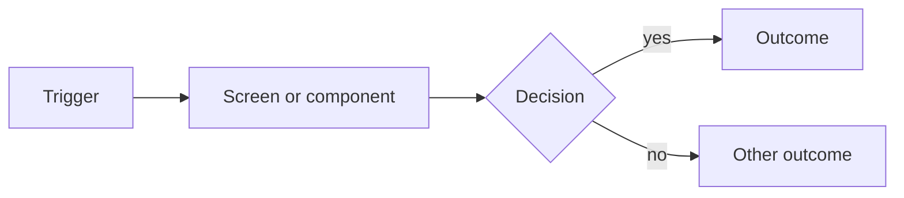
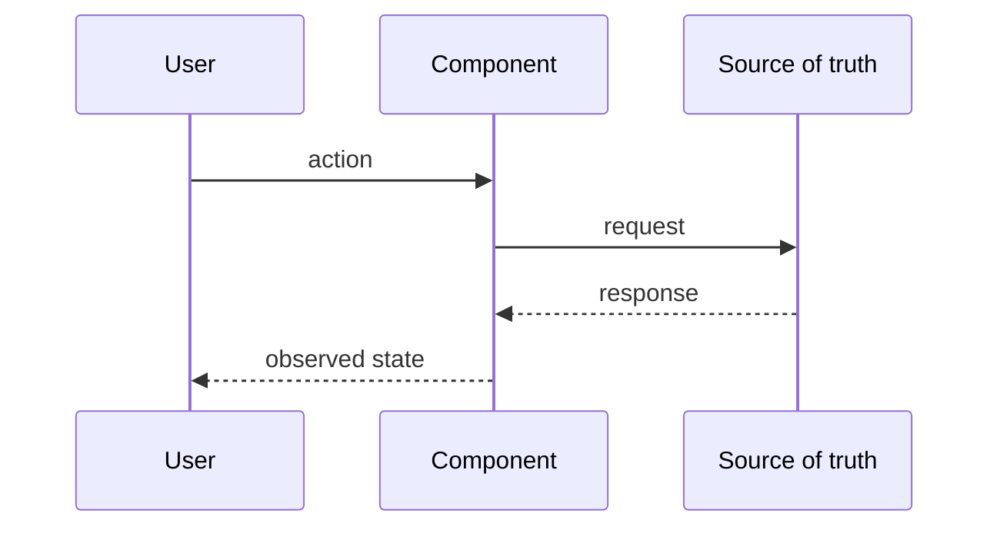

# Design proposal template

> **Status:** template · **Last reviewed:** 2026-10-21
>
> A design proposal is a **design artifact** that needs a review record: a mockup, a data flow, interaction notes. It is not
> the work queue. Authorization still comes from a row in `docs/PROPOSALS.md`, and this document names the row (or the
> consumer's local proposal) it supports. Convention: see the [README](../README.md#design-proposals-the-proposals-convention).
>
> Copy to `design-system/proposals/<YYYY-MM-DD>-<short-name>.md`, delete this block, and fill in every section. A section that
> does not apply says "Not applicable" and why; it is not deleted.

# `<Short title>`

| Field | Value |
|---|---|
| Status | Draft, Under review, Accepted, Rejected or Superseded |
| Date | `YYYY-MM-DD` |
| Author | `<name or role>` |
| Relates to | `<P-NNN queue row, or a consumer's local proposal>` |
| Hub tokens or components touched | `<list, or "none">` |
| Consumers affected | `<from crosswalk/consumers.md, or "hub only">` |

## Problem

What is wrong or missing, with evidence: a screen, a file and line, a contrast ratio, a consumer. Label each claim **Verified**,
**Sourced**, **Proposed** or **Blocked** (see the README). If the problem is "we want", say so.

## Proposal

One paragraph: what changes, and what stays the same.

## Mockup

At least one of the following, with the viewport, theme (light and dark) and state each one shows.

- **Mermaid** for flows, structure and sequences: it renders in GitHub and diffs as text.
- **SVG** for layout and visual design: it is text, so it diffs and reviews.
- **Image** only when neither fits. Keep it small; nothing over 5 MB is committed (`CLAUDE.md` §10).

## Data flow

What data the design reads, writes and shows, and where it lives. Name the source of each value.

| Datum | Source of truth | Shown where | Local or cloud | Notes |
|---|---|---|---|---|
| `<datum>` | `<system>` | `<screen>` | `<local or cloud>` | `<privacy, staleness, what happens when it is missing>` |

Show **observed** state, never optimistic state. Say whether each destination is local or cloud.

## Interaction notes

Cover each applicable item, and say "not applicable" for the rest.

- States: default, hover, focus, active, disabled, loading, empty, error, success.
- Keyboard: tab order, keys for each control, where focus starts and where it returns.
- Focus management: opening, closing, route changes, validation errors.
- Motion: durations from the motion tokens, and the reduced-motion behavior.
- Narrow widths and touch targets; light and dark.
- Copy: which register (see `voice-and-tone.md`), and the exact strings that matter.

## Accessibility

Contrast pairings the design introduces (add each to `contrast.pairs` in `tokens.yaml`), the WCAG success criteria it touches, labels
and names for assistive technology, and what was checked by hand. Do not write "accessible"; write what was checked.

## Token and component impact

| Item | New, changed or deprecated | Hub change or local override | Why |
|---|---|---|---|
| `<token or component>` | `<new / changed / deprecated>` | `<hub / local override>` | `<reason>` |

A local override is recorded in the affected consumer's pointer doc, with its rationale.

## Open questions

- [ ] `<question for the owner>`

## Decision gates

| Gate | Decision needed | Decided by | Evidence required | State |
|---|---|---|---|---|
| G1 | `<for example: accept the new token's values>` | `<owner>` | `<contrast pairs pass, mockups reviewed>` | open |
| G2 | `<for example: approve for adoption by consumers>` | `<owner>` | `<G1 closed, consumers' pointer docs updated>` | open |

Accepting a proposal is not approving a token: approval is recorded in `tokens.yaml`, with `approved_by` and `approved_on`.

## Out of scope

What this deliberately leaves open, so a reader does not assume it was decided here.

## Next steps

What must happen before this is Accepted, and who does it.
